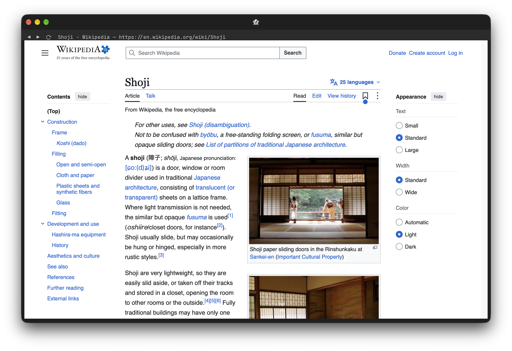

# shoji

**A real web browser in your terminal, drawn by WebKit — no Chrome.**

*Shoji* (障子) is the translucent paper screen in a wooden frame: the light and the world
outside show through it. Here, web pages show through your terminal.



For terminals that speak the kitty graphics protocol: Ghostty, kitty, WezTerm. macOS, and
Linux on WPE WebKit (agents' headless mode and the terminal) — see [Linux](#linux).

```sh
shoji https://example.com
shoji ./report.html --offline
```

## How light is it?

Next to headless Chrome (what other terminal browsers run on), same pages:

| | shoji | headless Chrome |
|---|---|---|
| Memory, tiny page | **77 MB** | 267 MB |
| Memory, Wikipedia article | **218 MB** | 351 MB |
| Processes | **4** | 12 |
| On disk | **0.4 MB** (WebKit is part of macOS) | 1.5 GB |
| Idle CPU, static page | **0.9%** of one core | — |
| Animated page | 30 fps, 34% of one core | — |

Details and method: [docs/performance.md](docs/performance.md).

## Install

Needs macOS 13+ and a terminal with the kitty graphics protocol (Ghostty, kitty, WezTerm).

From a release (one universal binary for Apple Silicon and Intel):

```sh
gh release download --repo kunalkushwaha/shoji --pattern '*.tar.gz'
tar -xzf shoji-*-macos-universal.tar.gz
install shoji-*/shoji ~/.local/bin/        # or anywhere on your PATH
```

From source (Xcode's Swift; no other dependencies):

```sh
git clone https://github.com/kunalkushwaha/shoji && cd shoji
swift build -c release
ln -s "$PWD/.build/release/shoji" ~/.local/bin/shoji
```

The page is live: scripts and animations run, and you click, scroll, hover and type into
it with the mouse and keyboard. Frames are sent only when the page changes.

| Keys | |
|---|---|
| `Ctrl+L` | type an address (or search words) |
| `Ctrl+R` | reload |
| `Ctrl+B` / `Ctrl+N` | back / forward |
| `Ctrl+Q` | quit |

The top bar's ◀ ▶ ⟳ are clickable; click the address to edit it.

## For agents: `shoji ctl`

Drive a page from the shell — made for coding agents like Claude Code, which can then
see what's on a page, act on it, and debug it:

```sh
shoji ctl open ./index.html              # starts a headless browser on first use, waits for the load
shoji ctl snapshot --view                # what's on screen, with short ids:
#   heading "Account settings" [e1] level=1
#   textbox "Full name" [e2] value=""
#   combobox "Country" [e3] selected="Japan" options=3
#   button "Save" [e6]
#   button "Bottom button" [e11] ↓        (↓ below the view; clicking scrolls to it)
shoji ctl fill e2 "Ada Lovelace"         # targets: an id, visible text, or a CSS selector
shoji ctl select Country India
shoji ctl check "Send me news"
shoji ctl click Save
shoji ctl errors                         # uncaught exceptions, console.error, failed or 4xx/5xx requests
shoji ctl console · network [--failed]   # everything logged / requested since the page loaded
shoji ctl screenshot page.png --full     # then look at the PNG
shoji ctl type "text" · key Enter · eval "document.title" · text "#msg" · scroll bottom · back
shoji ctl dialog dismiss                 # how confirm()/prompt() are answered (default: accept)
```

The headless browser quits after 30 idle minutes. `--name` keeps several apart;
`--offline` (when it starts) blocks everything remote — blocked requests show up in
`errors`. `--json` prints raw replies. Tested by `tests/agent_test.py`.

## Inside Neovim

`shoji --embed` draws a live page in a Neovim window through unicode placeholders
(the window's buffer holds the placeholder grid; frames reach the terminal through
`nvim_ui_send`). The Neovim side lives in the dotfiles (`Space m w` / `:Shoji`). An
embedded page also answers `shoji ctl --name <buffer's b:shoji>`, so an agent can
read and drive the very page you're looking at.

**Private:** nothing is stored between runs. **`--offline`:** every request that isn't a
local file is blocked by WebKit itself, so local reports and prototypes can't phone home.

## How it works

A `WKWebView` lives in an off-screen window (kept live with WebKit's occlusion check
turned off), is snapshotted when it changes, and each frame is handed to the terminal
as raw pixels through a temp file — no image data goes through the terminal stream. The
image is created once; after that only the rows that changed are written into it in place,
inside a synchronized update, so nothing flickers and typing or hovering sends little.
Mouse reports (SGR with pixel coordinates) and keys become `NSEvent`s for the page.
Measurements behind each choice: [docs/research.md](docs/research.md).

## Linux

`shoji ctl` and `shoji --headless` run on Linux with WPE WebKit 2.54+ (no Chrome), with the
same commands and output; `tests/agent_test.py` and `tests/more_test.py` pass. Made for
agents in containers:

```sh
docker build -t shoji .                      # Debian testing + WPE WebKit; --build-arg CJK=1 for CJK fonts
docker run -d --name shoji shoji             # a headless browser
docker exec shoji shoji ctl open https://example.com
docker exec shoji shoji ctl snapshot
```

Natively, on the two distros that ship WPE WebKit 2.54+ (`scripts/dist-linux.sh` builds
all of these into `dist/`, each in Docker against that distro's own libraries):

```sh
sudo apt install ./shoji_0.2.0-1_amd64.deb             # Debian testing/sid
sudo pacman -U shoji-0.2.0-1-x86_64.pkg.tar.zst        # Arch (packaging/arch/PKGBUILD)
```

Plus a bare binary, `shoji-*-linux-x86_64.tar.gz` (Debian testing/sid). Ubuntu, Fedora
and Debian 13 don't package WPE WebKit 2.54: use the Docker image there. Outside a
container, keep WebKit's sandbox on; inside one, the image sets
`WEBKIT_DISABLE_SANDBOX_THIS_IS_DANGEROUS=1` (the container is the sandbox).

In a terminal, from the image (Ghostty, kitty or WezTerm; Ctrl+Q quits):

```sh
docker run --rm -it shoji https://en.wikipedia.org/wiki/Shoji
docker run --rm -it -e SHOJI_SCALE=2 shoji …    # HiDPI screen: its scale (1.25, 1.5, 2)
```

The terminal can't read files inside the container, so frames go inline through the
terminal stream (zlib-compressed); the same happens over SSH. shoji finds out at start by
asking the terminal; `SHOJI_FRAMES=inline|file` decides instead. `--embed` (Neovim) works
on Linux too; with Neovim over SSH or shoji in a container, start Neovim with
`SHOJI_FRAMES=inline`. Numbers next to
headless Chromium: [docs/performance.md](docs/performance.md#linux); how it's built:
[docs/linux.md](docs/linux.md).

## Status

Early prototype. Not yet: right-click menus, tabs, downloads, WebGL/video capture,
hover inside Neovim, tmux. Linux: WebKit's sandbox is off in the Docker image.
